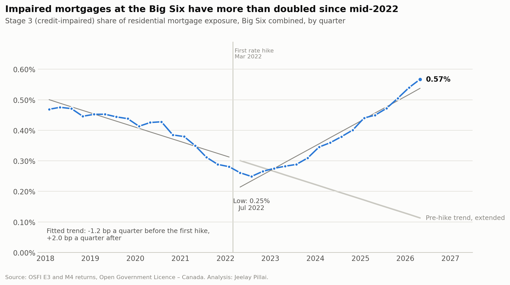
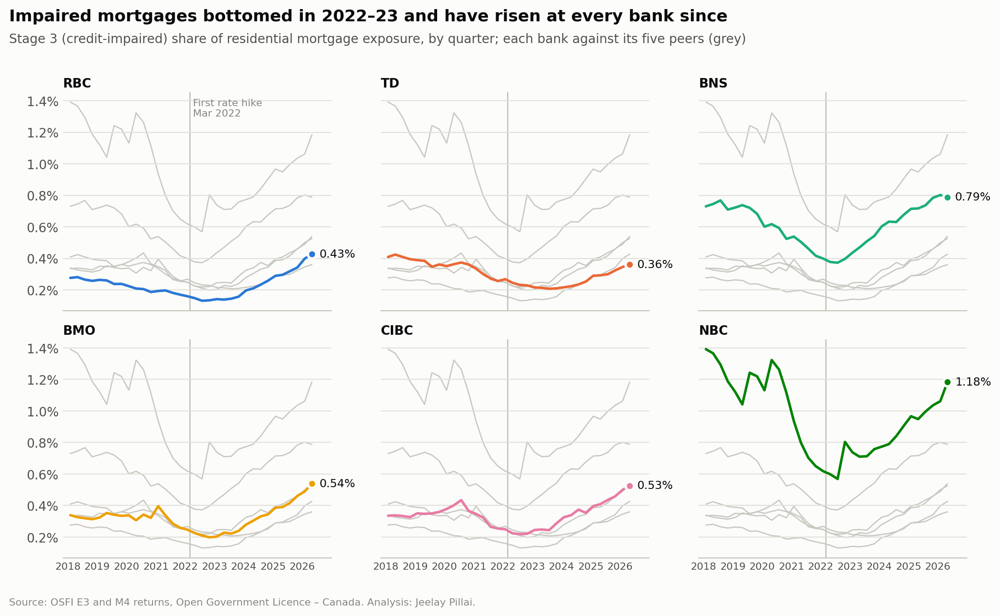

# Mortgage credit risk at Canada's Big Six banks

[](https://github.com/Jeelay1/osfi-mortgage-credit-risk/actions/workflows/ci.yml)

An end-to-end analysis of the regulatory returns Canada's six largest banks file with OSFI, from raw
government files to a PostgreSQL warehouse, statistical models in Python, and dashboards in Power BI and
Tableau. It follows the PACE framework (Plan, Analyze, Construct, Execute).

**The question.** About 60% of Canadian mortgages renew in 2025 and 2026, most at higher payments. Has
credit quality in the Big Six's $1.8 trillion residential mortgage book worsened since rates started rising
in March 2022? What drove the rise in loan-loss allowances, and where does the risk sit?



## Key findings (data to April 2026)

- **Impaired mortgages more than doubled from the low.** The Stage 3 (credit-impaired) share rose from 0.25%
  in July 2022 to 0.57% in April 2026, from $3.9 billion to $10.1 billion, and it is up at all six banks.
- **The trend reversed after the rate hikes.** An interrupted time-series model puts the trend at -1.2 basis
  points a quarter before the first hike and +2.0 after (p < 0.001), robust to the break date and to dropping
  the pandemic quarters.
- **Allowances rose 91%**, from $2.04 billion to $3.90 billion. A Shapley decomposition attributes 61% of the
  increase to loans migrating into Stages 2 and 3 and only 10% to banks holding more per dollar of loans.
- **The risk sits in uninsured mortgages:** 80% of the book but 94% of the allowance. The insured share of the
  book fell from 44% in 2018 to 22%.
- **The public data needed real work first.** 22 automated checks caught duplicate rows, line codes reused for
  a different measure, fiscal vs. calendar periods, two acquisitions, double-counted subsidiaries and a
  4-9% gap between TD's two returns. Each is fixed, worked around or disclosed.

The one-page [executive summary](reports/executive_summary.pdf) has the recommendations, and the
[notebook](notebooks/osfi_mortgage_credit_risk.ipynb) has the full analysis.



## What is in this repository

| Deliverable | Where |
|---|---|
| One-page executive summary for stakeholders | [`reports/executive_summary.pdf`](reports/executive_summary.pdf) |
| PACE analysis notebook (EDA, cleaning, models, results, recommendations) | [`notebooks/`](notebooks/osfi_mortgage_credit_risk.ipynb) |
| PostgreSQL warehouse: raw, core (star schema) and mart layers, plus data-quality checks | [`sql/`](sql/) |
| Power BI report: 6 pages, star-schema model, 82 DAX measures (Power BI Project with TMDL and PBIR) | [`powerbi/`](powerbi/) |
| Tableau workbook: 2 dashboards with parameters, LOD expressions and table calculations | [`tableau/`](tableau/) |
| Data dictionary, data-quality log, dashboard guide | [`docs/`](docs/) |
| Tests and CI that rebuild the warehouse from the raw files on every push | [`tests/`](tests/), [`.github/workflows/`](.github/workflows/ci.yml) |

## Skills shown

| Area | What | Where |
|---|---|---|
| SQL | Three-layer warehouse in PostgreSQL 16; star schema with conformed bank and month dimensions; CTEs, window functions (`LAG`, `RANK`, `ROW_NUMBER`), `FILTER` aggregates, `percentile_cont`, `corr`, `DISTINCT ON`, regex label parsing, a quarantine table for conflicting duplicates | [`sql/`](sql/) |
| Data quality | 22 checks (completeness, uniqueness, validity, consistency, reconciliation, comparability) written to a log table and rerun on every build | [`sql/04_quality_checks.sql`](sql/04_quality_checks.sql), [`docs/data_quality_log.md`](docs/data_quality_log.md) |
| Joining data at different grains | Quarterly E3 (each bank's fiscal quarters, gross of allowance) reconciled with monthly M4 (calendar months, net of allowance); fiscal year-ends verified statistically | [`sql/03_marts.sql`](sql/03_marts.sql) |
| Statistics | Interrupted time series (segmented regression) on a bank panel with Driscoll-Kraay standard errors, residual diagnostics, robustness checks; exact Shapley decomposition; stress (migration) test | [`src/analysis.py`](src/analysis.py) |
| Python | pandas, statsmodels, matplotlib; the notebook is generated and executed from code, every number in its text is computed from the data, and the claims in chart titles are asserted | [`src/`](src/) |
| Power BI | Star schema; DAX with `CALCULATE`, semi-additive balances, year-over-year without auto date tables, `RANKX`, `MEDIANX`, a `SWITCH` metric selector, a what-if scenario, dynamic titles; Power Query function and parameters; conditional formatting | [`powerbi/`](powerbi/), [`docs/dashboards.md`](docs/dashboards.md) |
| Tableau | Parameter-driven metric, nested `FIXED` LOD expressions, `RANK` table calculation, dashboard layout | [`tableau/`](tableau/) |
| Communication | Executive summary, chart titles that state the finding, accessible colour palette | [`reports/`](reports/) |
| Engineering | Reproducible pipeline (`make all`), pytest suite, GitHub Actions that rebuild every table from the raw snapshot and compare | [`Makefile`](Makefile), [`tests/`](tests/) |
| Banking domain | IFRS 9 staging, expected credit loss allowances, coverage, insured vs. uninsured mortgages, OSFI returns | notebook section 2.2 |

## Dashboards

**Power BI** (`powerbi/MortgageCreditRisk.pbip`): Overview, Metric explorer, Allowances, Mortgage book,
Trend model and Data quality pages. Open it in Power BI Desktop and select **Refresh**: the model reads the
CSVs straight from this repository. **Tableau** (`tableau/OSFI_Mortgage_Credit_Risk.twbx`): Credit quality and
Mortgage book dashboards. [`docs/dashboards.md`](docs/dashboards.md) explains each page and measure and lists
the numbers each page should show.

<!-- Screenshots: add docs/img/powerbi_overview.png and docs/img/tableau_credit_quality.png here once published. -->

## Data quality: the issues that mattered most

| Issue | Effect if missed | What was done |
|---|---|---|
| E3 is labelled by each bank's fiscal quarter, M4 by calendar month | Comparisons off by up to three months | Quarter-end dates derived from each bank's year-end, verified by testing every offset from -3 to +3 months |
| E3 reports loans gross of the allowance, M4 net | The two returns never agree | Reconciled E3 gross minus allowance to M4 for every bank and quarter: BMO, BNS and CIBC agree (NBC once reverse mortgages are added), RBC is within 0.3%, and TD's 4-9% gap is flagged as open |
| RBC bought HSBC Canada (2024) and National Bank bought Canadian Western Bank (2025) | Year-over-year growth overstated by up to 8 points (RBC) and 11 points (NBC) | Organic growth series that removes the acquired book for 12 months |
| Line codes 3193-3201 changed meaning in 2018 | Two different measures spliced into one series | Line items keyed on code + label |
| Bank-owned subsidiaries file their own returns | Adding up banks overstates the industry by $57-120 billion | Subsidiaries identified; the analysis never sums institutions |

The full log is in [`docs/data_quality_log.md`](docs/data_quality_log.md).

## Reproduce it

Requirements: Python 3.11+ and PostgreSQL 16. The OSFI files used are committed as a compressed snapshot, so
no download is needed.

```bash
pip install -r requirements.txt
export DATABASE_URL=postgresql://postgres@localhost:5432/osfi   # an empty database
make all     # warehouse -> exported tables -> models -> notebook -> executive summary -> docs
make test    # 25 tests
```

`make all` runs, in order: `src/build_database.py` (load and model in SQL, about 10 seconds),
`src/export_marts.py`, `src/analysis.py`, `src/build_notebook.py`, `src/build_summary.py` and
`src/build_docs.py`. To use OSFI's
latest release instead of the snapshot, run `make data` first (see [`data/README.md`](data/README.md)).

## Project structure

```
├── data/
│   ├── raw/                 OSFI E3 snapshot (.csv.gz) and data dictionary
│   ├── interim/             M4 extract (.csv.gz)
│   └── processed/           tables for the notebook and dashboards
├── sql/                     00 schemas · 01 dimensions · 02 facts · 03 marts · 04 quality checks
├── src/                     pipeline, analysis, charts, notebook and summary builders
├── notebooks/               PACE analysis notebook
├── powerbi/                 Power BI Project (TMDL semantic model + PBIR report)
├── tableau/                 Tableau packaged workbook
├── reports/                 executive summary and figures
├── docs/                    data dictionary, data-quality log, dashboard guide
└── tests/                   data, analysis and dashboard tests
```

## Data and licence

Source: Office of the Superintendent of Financial Institutions (OSFI),
[Banks financial data](https://open.canada.ca/data/en/dataset/91ed76b4-a1a2-4f87-9c4c-59cd64f7a9de), returns
E3 (Allowances for Expected Credit Losses) and M4 (Consolidated Balance Sheet). Contains information licensed
under the [Open Government Licence – Canada](https://open.canada.ca/en/open-government-licence-canada).
Code is under the MIT licence.

Figures are reported accounting estimates from public, aggregate data. They describe trends; they are not a
statement about any bank's safety and not investment advice.

**Author:** Jeelay Pillai, Thunder Bay, Ontario
